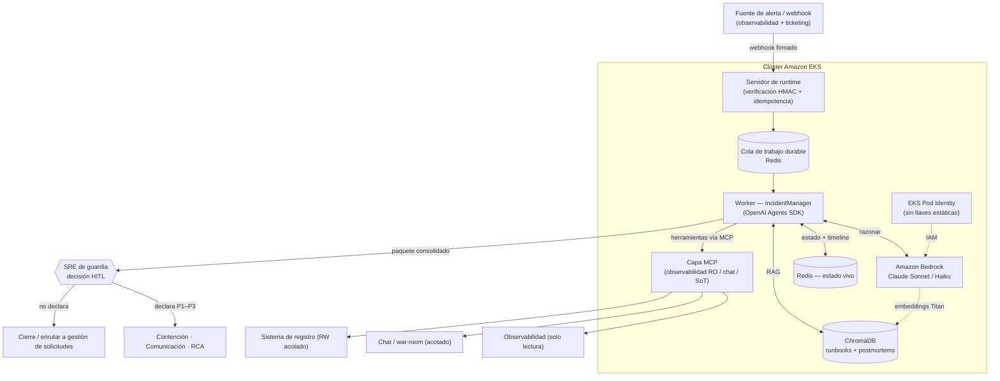
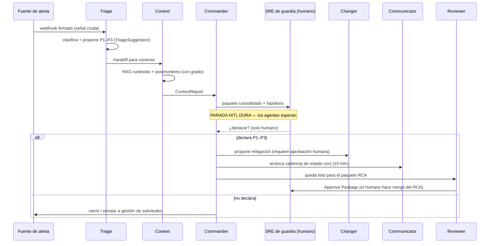

# Agentes de IA para Respuesta a Incidentes — Copiloto SRE Multiagente

Un clúster de **6 agentes de IA especializados** que asiste a un equipo SRE de guardia
durante incidentes de producción en una fintech de pagos. El sistema clasifica alertas,
recupera contexto histórico, propone mitigaciones y mantiene informados a los interesados
— **sin tomar nunca una decisión crítica por su cuenta**. Toda acción de alto riesgo queda
detrás de una compuerta *human-in-the-loop* (HITL), forzada en el código, no solo en los
prompts.

> Construido sobre el **OpenAI Agents SDK**, **Amazon Bedrock** (Claude), **Amazon EKS**
> y el **Model Context Protocol (MCP)**. Desplegado con GitOps (ArgoCD) y validado de
> punta a punta contra infraestructura cloud real.

---

## Tabla de contenido

- [El problema](#el-problema)
- [Qué hace el sistema](#qué-hace-el-sistema)
- [Arquitectura en una vista](#arquitectura-en-una-vista)
- [Los 6 agentes](#los-6-agentes)
- [Flujo del incidente (de punta a punta)](#flujo-del-incidente-de-punta-a-punta)
- [Cómo se fuerza la seguridad (3 capas)](#cómo-se-fuerza-la-seguridad-3-capas)
- [Stack tecnológico y por qué](#stack-tecnológico-y-por-qué)
- [Memoria y RAG — embeddings en Bedrock](#memoria-y-rag--embeddings-en-bedrock)
- [Desafíos y cómo los superamos](#desafíos-y-cómo-los-superamos)
- [Beneficios](#beneficios)
- [Estado y alcance honesto](#estado-y-alcance-honesto)
- [Qué aprendí](#qué-aprendí)

---

## El problema

Cuando un incidente de producción golpea una plataforma de pagos, los primeros 15 minutos
son caos: alguien tiene que leer la alerta, juzgar qué tan grave es, bucear entre
dashboards y postmortems viejos, decidir si se declara formalmente un incidente, abrir un
war room y mantener a todos actualizados con una cadencia estricta — todo a la vez, muchas
veces a las 3 de la mañana.

La mayor parte de ese trabajo es **recopilación repetitiva de contexto y comunicación**, no
juicio. El juicio (¿esto es realmente un Sev-1? ¿declaramos? ¿aplicamos esta mitigación?)
debe seguir siendo humano. Así que el objetivo nunca fue reemplazar al SRE — fue **quitar
el trabajo rutinario alrededor de la decisión** para que el humano decida más rápido y con
mejor información.

## Qué hace el sistema

- **Clasifica** una alerta entrante y propone una prioridad preliminar (P1–P3) y un subtipo.
- **Recupera contexto** desde una base de conocimiento vectorial: runbooks y postmortems
  históricos que hacen match, cada uno con un grado de confianza.
- **Consolida hipótesis** y presenta un único paquete al ingeniero de guardia.
- **Se detiene y espera** a que un humano decida si se declara el incidente (compuerta HITL
  dura).
- Una vez el humano declara, se ramifica para **contener, comunicar y documentar**: propone
  un plan de mitigación, mantiene una cadencia de estado vivo cada 10 minutos y arma un
  paquete estructurado de RCA/postmortem para revisión humana.

Los agentes **analizan, contextualizan, proponen y asisten. El humano mantiene el control
de toda decisión crítica.**

---

## Arquitectura en una vista

> Fuente editable del diagrama: [`architecture.mmd`](architecture.mmd) (Mermaid).

**Forma del diseño:**

- Un **runtime durable**: el webhook no procesa de forma síncrona. Verifica la firma HMAC,
  chequea idempotencia, encola el trabajo en Redis y responde `202` de inmediato. Un worker
  drena la cola y corre el flujo de agentes. Si un pod se reinicia a mitad de incidente, el
  trabajo en vuelo se recupera y las decisiones HITL sobreviven porque viven en el sistema
  de registro, no en memoria.
- Un único **orquestador** (Commander) coordina a los 5 especialistas mediante los
  *handoffs* del SDK. Los especialistas nunca se auto-delegan entre sí.
- Todo acceso externo pasa por la **capa MCP** o por clientes dedicados — el LLM nunca llama
  directamente a una API externa.

---

## Los 6 agentes

| Agente | Modelo | Salida tipada | Puede hacer | **NO puede hacer (forzado)** |
| --- | --- | --- | --- | --- |
| **Commander** | Sonnet (razonamiento fuerte) | *(coordina)* | Delegar vía handoffs, evaluar hipótesis, desafiar hallazgos | Cualquier efecto externo · declarar · correr el reloj de escalamiento |
| **Triage** | Haiku (rápido / económico) | `TriageSuggestion` | Clasificar bug/feature, tamaño, producto; proponer impacto/urgencia/prioridad | Fijar la prioridad final · abrir canales · declarar · delegar |
| **Context** | Haiku | `ContextReport` | Investigar observabilidad (solo lectura) + runbooks/postmortems (RAG); sugerir runbook con grado de confianza | Ejecutar remediación · inventar un runbook · decir "limpio" sin cobertura |
| **Changer** | Haiku | `MitigationProposal` | Proponer un plan de mitigación; efectos acotados vía MCP | Merge · aprobar · deploy autónomo · declarar · paginar |
| **Communicator** | Haiku | `LiveStatus` | Estado vivo cada 10 min; difundir ACK/escalamiento; repetir el enlace del war room que un humano proveyó | Disparar el aviso · correr el reloj · inventar un ACK · declarar resuelto · crear el war room |
| **Reviewer** | Sonnet | `RcaPackage` | Compilar un paquete RCA *blameless* en Markdown | Merge · sustituir la aprobación humana · abrir el PR |

La división por "nivel de modelo" es deliberada: **Haiku** económico/rápido para el trabajo
de alto volumen de los especialistas, **Sonnet** fuerte para los dos roles que necesitan
razonamiento más profundo (orquestación y síntesis del RCA). Re-ajustar el balance
costo/calidad es un cambio de una línea en configuración.

---

## Flujo del incidente (de punta a punta)

Momento clave: después de que Context y Commander consolidan todo, **el sistema se detiene
y espera**. Nunca declara. El ingeniero de guardia aplica las pruebas de decisión y elige.
Esa parada es el corazón del diseño.

---

## Cómo se fuerza la seguridad (3 capas)

Esta es la parte de la que estoy más orgulloso. "El humano mantiene el control" no es una
frase en un prompt — es **defensa en profundidad**, de forma que aunque un modelo alucine,
la acción insegura sea estructuralmente imposible:

1. **Esquemas tipados (Pydantic).** La salida del Triage *no tiene un campo* para declarar
   un incidente. No puedes emitir una decisión que no existe en el tipo. Las reglas de
   negocio quedan codificadas en el sistema de tipos, no en instrucciones que el modelo
   podría ignorar.
2. **Guardrails del SDK.** Guardrails de entrada/salida disparan un "tripwire" que detiene
   la ejecución si un agente intenta declarar, producir un efecto externo (Commander) o
   afirmar un merge/deploy (Changer).
3. **Compuerta HITL programática.** El orquestador se niega a continuar más allá de la
   declaración sin un aprobador humano identificado. Sin humano, no hay avance.

Además: **mínimo privilegio** por agente, acceso **solo lectura** a observabilidad, y un
cliente de paginación cuyos métodos `trigger_page()` / `acknowledge()` lanzan a propósito
`NotImplementedError` — un agente físicamente no puede paginar a alguien ni falsear un
acuse de recibo.

---

## Stack tecnológico y por qué

| Capa | Elección | Por qué |
| --- | --- | --- |
| Framework de agentes | **OpenAI Agents SDK** | Orquestación multiagente programática con handoffs tipados y salidas estructuradas — control sobre el flujo en vez de una caja negra. |
| Inferencia | **Amazon Bedrock** (Claude Sonnet / Haiku) | Sin llaves de API estáticas — auth vía **EKS Pod Identity**; facturación y auditoría dentro de AWS; inference profile cross-region para disponibilidad. |
| Runtime | **Amazon EKS** (Deployment estándar de Kubernetes) | Siempre-on, declarativo, amigable con GitOps. Se descartó un enfoque de operador más pesado a favor de un contenedor simple y portable. |
| Acceso a herramientas | **Model Context Protocol (MCP)** | Aísla a los agentes de las APIs externas detrás de servidores dedicados (MCP oficial de observabilidad + wrappers propios), forzando mínimo privilegio. |
| Conocimiento / RAG | **ChromaDB** | Un solo backend vectorial, dos colecciones (runbooks + postmortems). Recuperación determinística — el runbook sale del índice, nunca del modelo. |
| Estado a corto plazo | **Redis** | Estado vivo del incidente, timeline, cola de trabajo durable, claves de idempotencia — sobrevive reinicios de pod. |
| Entrega | **Docker + ArgoCD (GitOps)** | Imágenes firmadas, manifiestos declarativos, promoción por tag. |

**Descartado a propósito:** herramientas de automatización visual de propósito general
(p. ej. constructores de flujos drag-and-drop). Todo esto es un microservicio limpio,
auditable y testeable — infraestructura y comportamiento como código.

---

## Memoria y RAG — embeddings en Bedrock

El conocimiento (runbooks + postmortems) vive en **ChromaDB** como memoria vectorial
unificada: un solo backend, dos colecciones. La recuperación es **determinística** — el
runbook se resuelve contra el índice con un umbral de distancia, no se deja a la
imaginación del modelo.

La dirección de la arquitectura para los **embeddings es Amazon Bedrock (Titan)**, en lugar
del embedder local por defecto. El motivo es consistencia con el resto del diseño:

- **Sin descargas ni cache local.** El embedder local obliga a un sistema de archivos
  escribible (el pod corre con `readOnlyRootFilesystem`) y descarga un modelo al arrancar.
  Titan lo elimina: el pod ya tiene acceso a Bedrock vía Pod Identity.
- **Una sola superficie de inferencia.** Razonamiento y embeddings pasan por el mismo
  proveedor, con la misma autenticación sin llaves y la misma auditoría.
- **Menos CPU/memoria en el pod** y un arranque más limpio.

> Estado: **planificado, aún no construido.** Hoy la ingesta usa el embedder por defecto de
> ChromaDB. Migrar a Titan implica cambiar la *embedding function*, **recargar toda la
> colección** y **recalibrar el umbral de distancia** del match de runbooks (la escala de
> distancia cambia con el embedder). Se documenta aquí como la evolución natural, no como
> algo ya entregado.

---

## Desafíos y cómo los superamos

Algunos de los problemas más interesantes de resolver, y cómo se abordaron:

### 1. El modelo inventaba runbooks

**Problema:** al principio el modelo citaba con total confianza runbooks que no existían —
una alucinación peligrosa en medio de un incidente.

**Solución:** la resolución del runbook pasó a ser **determinística** en el orquestador. El
modelo ya no elige el runbook; el orquestador busca en el índice vectorial y aplica un
**umbral de distancia**. Por debajo del umbral devuelve un match real con su grado de
confianza; por encima, reporta honestamente "sin match confiable" en vez de inventar uno.
El LLM propone; el índice decide.

### 2. Los modelos nuevos de Claude rechazaban la salida estructurada forzada

**Problema:** la salida estructurada se apoyaba originalmente en *forced tool use* (forzar
una tool para obtener JSON tipado). Las generaciones más nuevas de Claude rechazan ese
patrón, lo que rompía el pipeline estructurado al migrar de modelo.

**Solución:** se migró a la **feature nativa de salida estructurada de Bedrock**. Eso
además obligó a tres ajustes: hacer el esquema JSON estricto (`additionalProperties: false`
de forma recursiva), manejar el bloque de *extended thinking* que el modelo emite antes del
texto, y **agrupar correctamente** los bloques de *tool-use* y *tool-result* por turno en
los ciclos multiturno. Todo validado empíricamente contra el modelo real desde dentro del
pod, no solo en local.

### 3. El runtime tenía que sobrevivir reinicios y errores transitorios

**Problema:** un webhook síncrono es frágil — si el pod se reinicia o el proveedor de
inferencia devuelve un `500` transitorio, el incidente a medio procesar se pierde.

**Solución:** un **runtime durable**. El webhook responde `202` rápido y encola en Redis; un
worker drena la cola con reintentos acotados y recuperación del trabajo en vuelo. Los `500`
transitorios del proveedor se reintentan solos (cero mensajes muertos en las pruebas). Y lo
más importante: la **decisión humana vive en el sistema de registro**, no en memoria, así
que sobrevive a un reinicio del pod a mitad de incidente.

### 4. Conectividad segura al endpoint de inferencia

**Problema:** el pod no lograba alcanzar el endpoint de inferencia; una política de egress
ingenua por bloque de IP no cubría la entidad de red correcta del CNI.

**Solución:** una **política de egress precisa** (entidad `host` del CNI) en vez de un
`ipBlock` genérico. Buen recordatorio de que "mínimo privilegio" tiene que ser *correcto*,
no solo restrictivo.

### 5. La IA no debe poder tomar la decisión crítica — ni por accidente

**Problema:** confiar en el prompt para que un agente "no declare un incidente" es frágil;
tarde o temprano un modelo hará lo que se le pidió no hacer.

**Solución:** hacer la acción insegura **irrepresentable**. Si la salida del Triage no tiene
un campo para declarar, el modelo no puede declarar aunque quiera. Sumado a los guardrails
del SDK y a la compuerta HITL programática, la seguridad deja de depender del texto del
prompt.

---

## Beneficios

- **Menor tiempo a contexto.** Los minutos que normalmente se van cazando dashboards y
  postmortems viejos se colapsan en un único paquete consolidado que se entrega al ingeniero.
- **Comunicación consistente.** Estado vivo en una cadencia exacta de 10 minutos, siempre,
  sin que un humano tenga que acordarse de publicar.
- **Auditable por diseño.** Logging estructurado en JSON, sobres tipados entre agentes,
  webhooks firmados — cada paso es trazable.
- **Consciente del costo.** Nivel de modelo económico para el trabajo de alto volumen,
  nivel fuerte solo donde el razonamiento lo amerita.
- **Seguro de adoptar.** Como las acciones críticas están bloqueadas en el código, el peor
  caso es "el agente no hizo nada útil", nunca "el agente declaró un Sev-1 por su cuenta".

---

## Estado y alcance honesto

Esto se construyó como un MVP y se validó **de punta a punta en un clúster real**: un
webhook firmado despierta el flujo, Triage y Context corren contra Bedrock real +
herramientas de observabilidad, el runbook se recupera del índice y el flujo se detiene en
la compuerta HITL. Los modelos se migraron después a la generación actual de Claude sin
romper el pipeline estructurado.

Para ser honesto:

- La **capa de ejecución durable** y la integración con el sistema de registro las construyó
  un compañero de plataforma **encima** del núcleo de agentes; la lógica de los 6 agentes,
  los guardrails y el dominio no cambiaron. Lo que muestro aquí es la arquitectura de agentes
  y el modelo de seguridad, que son míos.
- Algunas integraciones (servidores MCP de chat / sistema de registro) se entregaron primero
  como *scaffolds* y se completaron en fases posteriores.
- Los embeddings en Bedrock (Titan) están **planificados, no construidos** (ver la sección
  de memoria y RAG).
- Nombres de servicios, hosts, identificadores de cuenta y runbooks específicos de la empresa
  se omiten a propósito.

---

## Qué aprendí

- **Los guardrails van en los tipos y el código, no en los prompts.** Si una acción insegura
  es representable, un modelo tarde o temprano la tomará. Hazla irrepresentable.
- **Determinismo donde importa.** La recuperación RAG y la selección de runbook no deben
  dejarse a la imaginación del modelo — resuélvelas de forma determinista y deja que el
  modelo razone sobre el resultado.
- **Diseña para el runtime que realmente tienes.** Errores transitorios del proveedor,
  reinicios de pod y trabajo en vuelo no son casos borde en producción; el patrón de cola
  durable + HITL en el sistema de registro hizo que el sistema fuera aburrido, en el mejor
  sentido.
- **"Aumentar, no reemplazar" es una arquitectura, no un eslogan.** Cada frontera de este
  sistema existe para mantener al humano en el bucle de decisión.

---

*Sistema multiagente de IA · Python · OpenAI Agents SDK · Amazon Bedrock (Claude) ·
Amazon EKS · MCP · ChromaDB · Redis · GitOps/ArgoCD.*
